<picture>
  <source media="(prefers-color-scheme: dark)" srcset="assets/header-dark.svg">
  
</picture>

 

I write software for three very different rooms: the estimating desk on a construction project, the back office of a small business, and the living room.

 

<table>
<tr>
<td width="33%" valign="top">

#### 🏗️ Construction economics
Cost estimating and quantity take-off tools: measurements in, priced bills out.

private projects

</td>
<td width="33%" valign="top">

#### 📊 ERP & business apps
Bookings, clients, invoicing and the day-to-day workflows a company actually runs on.

private projects

</td>
<td width="33%" valign="top">

#### 📺 Apple TV
[**NuvioTV**](https://github.com/esalwey/NuvioTV): Nuvio, made for Apple TV. Native SwiftUI on a Kotlin Multiplatform core.

open source · GPL-3.0

</td>
</tr>
</table>

### Coming soon

**tvsign**: keeps sideloaded apps alive on Apple TV with a free Apple ID. Signs, installs over Wi-Fi, renews before day 7. Windows app, or Docker for a NAS / Raspberry Pi.

### Toolbox

  

FR / EN · je réponds aussi en français.
